# MechAgent

**An AI engineering agent that turns a plain-text specification into a verified mechanical
part, with its simulation, its optimization, a PDF engineering report and a STEP CAD file.**


> **The LLM orchestrates, deterministic tools compute.** The language model reads the
> request and picks the next step among the actions engineering rules allow. Every stress,
> displacement, mass and fatigue life comes from a real solver, never from the LLM.


## Overview

| You give it                                                   | It gives you back                                                    |
| ------------------------------------------------------------- | -------------------------------------------------------------------- |
| A short text: mounting points, load, deflection limit, safety factor, material family | A bracket designed, meshed, simulated with finite elements, optimized for minimum mass and checked |
|                                                               | A [PDF engineering report](docs/media/example_report.pdf) with every check, assumption and decision |
|                                                               | A [STEP model](docs/media/example_design.step) placed in your global frame, ready for CAD |

Result of the run shown below (titanium shelf bracket, 2000 N static load), about 20 minutes
on a laptop:

| Mass      | Max displacement         | Yield safety factor     | Checks passed | Status       |
| --------- | ------------------------ | ----------------------- | ------------- | ------------ |
| 960.5 g   | 1.86 mm (limit 2 mm)     | 7.34 (required 2)       | 10 / 10       | **VERIFIED** |

A second example, an aluminium wall bracket under a cyclic load of one million cycles,
ends verified at 239 g of Al7075-T6, 19 % lighter than the first iteration after the LLM
chose to refine the search.

## Agentic workflow

The agent is a [LangGraph](https://github.com/langchain-ai/langgraph) state graph. The LLM
appears at only two points: reading the request and choosing between actions the rules
already allow. Everything else is engineering rules and deterministic tools, and every node
writes its decision to the trace with its source.

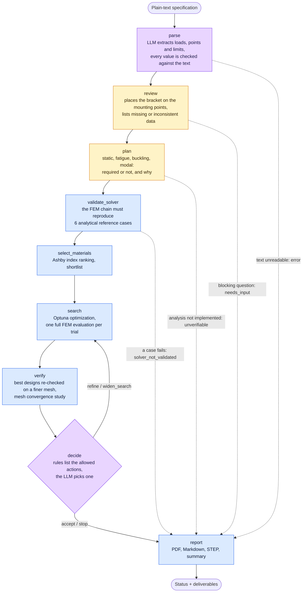

🟪 LLM &nbsp; 🟦 deterministic tool &nbsp; 🟨 engineering rule &nbsp; · &nbsp; dotted arrows
stop the run early with an explicit status instead of producing an unchecked design.

### How a decision is made

The LLM never chooses freely. After each verification, the rules compute which actions are
allowed; the LLM only arbitrates when there is more than one, and an answer outside the
list falls back to the rule default.

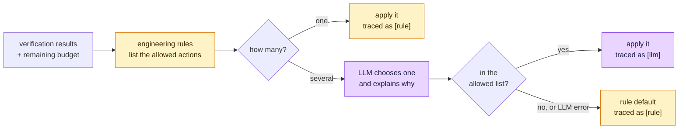

| Situation after verification                                              | Allowed actions        |
| ------------------------------------------------------------------------- | ---------------------- |
| Valid design, a requirement within 10 % of its limit, or no iteration left | `accept`               |
| Valid design with margin left on every requirement                        | `refine`, `accept`     |
| Valid designs found, none passed the final verification                   | `refine`, `stop`       |
| No valid design found                                                     | `widen_search`, `stop` |
| No valid design and no iteration left                                     | `stop`                 |

In the titanium run, the LLM chose `refine` after iteration 1 (14 % margin on displacement,
1004.7 g). After iteration 2 (7 % margin, 960.5 g) the rules allowed only `accept`.

### What one optimization trial runs

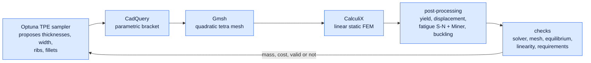

## How it works

### 1. Describe the part in plain text

The LLM extracts the request, then every number and vector it read is checked against the
original text. The agent places the bracket on the mounting points and decides which
analyses are needed (static, fatigue, buckling, modal), each with its reason.

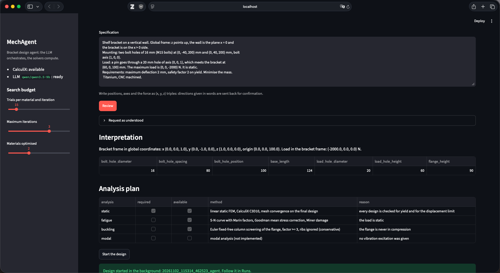

<details>
<summary>Empty home screen, with the solver and LLM status and the search budget</summary>

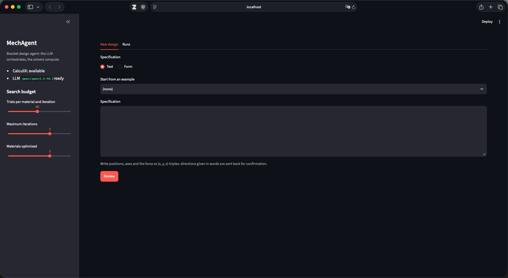

</details>

### 2. The agent designs, simulates and iterates

The run continues in the background. The agent validates the solver against analytical
cases, ranks materials, optimizes the geometry with Optuna and decides whether to refine,
widen, accept or stop. Every decision is logged with its source: `[rule]`, `[llm]` or
`[tool]`.

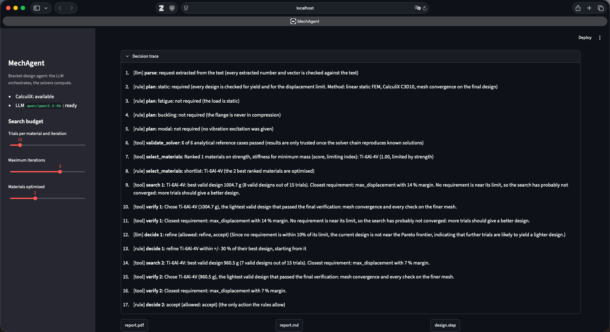

### 3. A verified design, with its evidence

A design is only declared **verified** once every required check has run and passed,
including a mesh convergence study on a finer mesh.

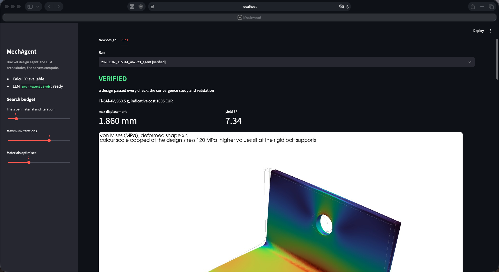

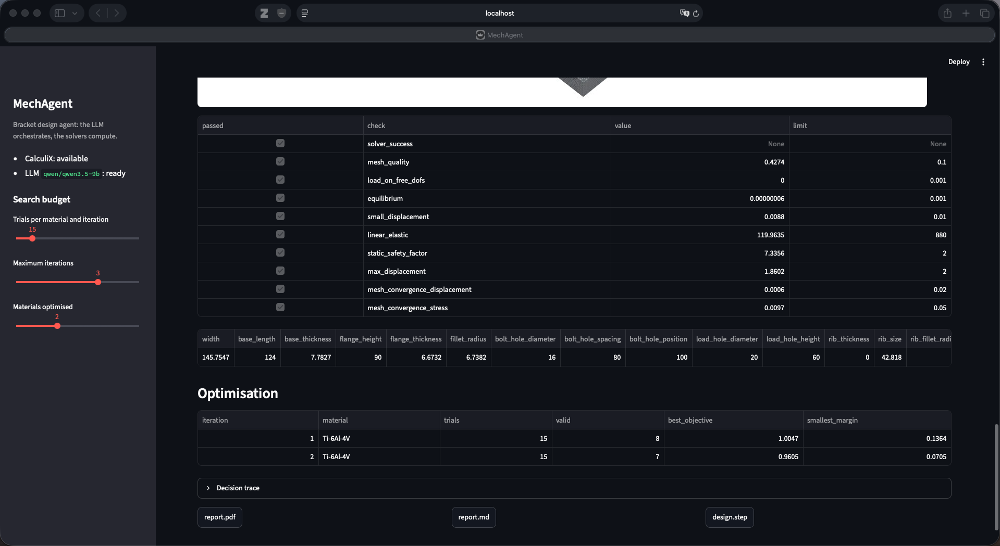

| Von Mises stress (MPa)                            | Displacement (mm)                                     |
| ------------------------------------------------- | ----------------------------------------------------- |
| 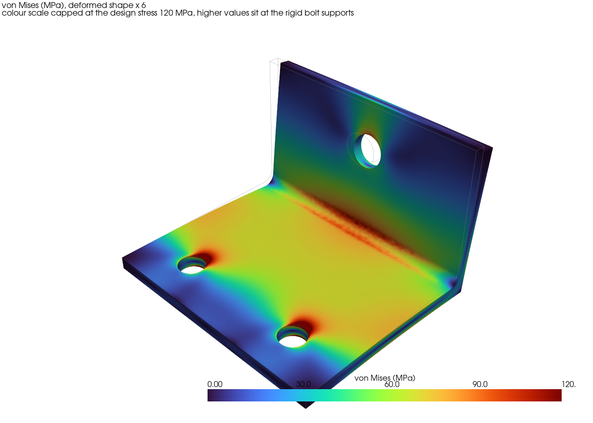 | 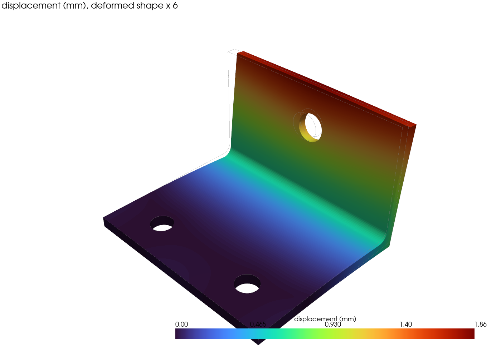 |

### 4. Deliverables

<a href="docs/media/example_report.pdf">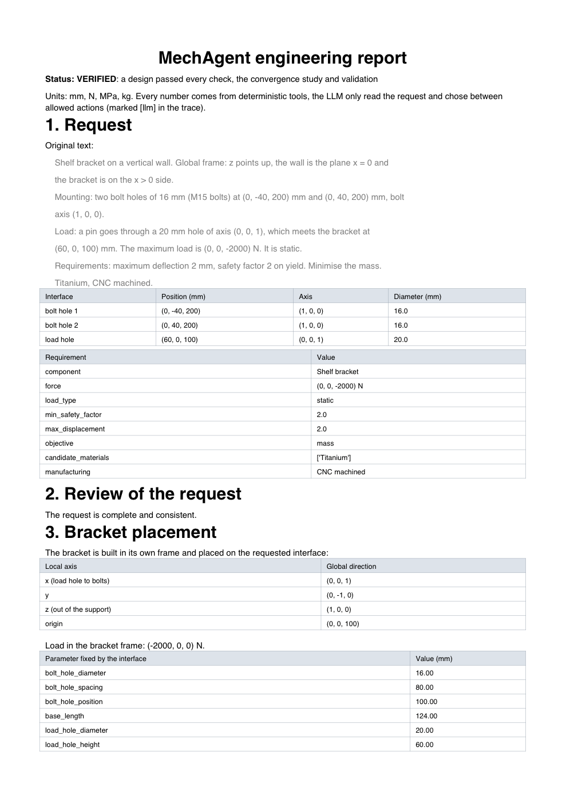</a>

Each run produces:

- **[report.pdf](docs/media/example_report.pdf)**: the request, its review, the bracket
  placement, the analysis plan, the solver validation, the material ranking, every
  optimization iteration, every check with its limit, the figures, the assumptions and the
  full decision trace
- **[design.step](docs/media/example_design.step)**: the final geometry in the global
  frame of the request, ready to open in any CAD tool
- `report.md` and `summary.json`, for reading or for other tools

Click the page on the right to open the full example report.

<br clear="right">

## Area of work

| Area                              | What is in the project                                                                                       | Tools                               |
| --------------------------------- | ------------------------------------------------------------------------------------------------------------ | ----------------------------------- |
| **Finite element analysis**       | Linear static FEM with quadratic tetrahedra, mesh quality and equilibrium checks, mesh convergence, validation against 6 analytical cases | CalculiX, Gmsh                      |
| **Fatigue and strength**          | S-N curves, Marin factors, Goodman / Gerber / Soderberg mean stress correction, rainflow counting, Miner damage, buckling screening | NumPy, SciPy                        |
| **Parametric CAD**                | Parametric L bracket with ribs and fillets, placement on arbitrary mounting points by frame transforms, STEP export | CadQuery (OpenCascade)              |
| **Optimization and materials**    | Mass minimization under constraints, warm-started refinement, material ranking with Ashby indices, cost model | Optuna                              |
| **AI agents and LLMs**            | Agent as a state graph, local LLM, decisions restricted to rule-allowed actions, every extracted value checked against the source text, decision trace | LangGraph, LangChain, LM Studio (Qwen) |
| **Software engineering**          | Typed data models, validated configuration, single unit system enforced, 186 tests (unit tests with a fake LLM and smoke tests on the real solvers), linting, packaging | Pydantic, pytest, ruff, conda       |
| **Visualization and reporting**   | 3D result figures, PDF report generation, web interface with background runs                                 | PyVista, ReportLab, Streamlit       |

## Architecture

```
                 ┌──────────────────────────────────────────┐
  requirements → │ agent/ LangGraph workflow (local LLM)    │ → report, STEP
                 └──────┬──────────┬──────────┬─────────────┘
                        │ calls deterministic tools
        ┌───────────────┼──────────┼──────────┼──────────────────┐
        ▼               ▼          ▼          ▼                  ▼
      cad/        simulation/  materials/  optimization/     reporting/
   CadQuery      Gmsh mesh,    material    Optuna parametric  PDF report,
   bracket       CalculiX FEM, database,   search             PyVista figures
                 fatigue       selection
                        ▲
                 core/  config, logging, units, environment checks, shared data models
                 app/   Streamlit interface on top of the agent
```


## Quick start

```bash
conda env create -f environment.yml
conda activate mechagent
mechagent-check-env   # lists every package, program and service needed
mechagent-app         # opens the Streamlit interface
```

The agent needs a local LLM served by [LM Studio](https://lmstudio.ai) on port 1234
(default model `qwen/qwen3.5-9b`):

```bash
lms load qwen/qwen3.5-9b
lms server start
```

In the app, pick the `wall_bracket` example, click **Review**, then **Start the design**.


## Limitations and next steps

The first supported component is a two-bolt L bracket, optimized parametrically (not by
topology optimization). Modal analysis is not implemented yet, so a request that needs it
is marked unverifiable rather than passed. Next steps: a contact-based bolted joint model,
buckling and modal FEM, more component types, and a Pareto front of mass against cost.
